# New Super Paper Bros.

(This section written by me, a human.) FORK - [Super Paper Mario Deluxe + The Lost Pages. This fork will include lots of content on my idea of a proper remaster of SPM. Please be patient!]

A native PC port of **Super Paper Mario** (Wii, 2007), made by statically recompiling the game's PowerPC code to C++
with [WiiCompiled](https://github.com/patchzyy/Wiicompiled). No emulator: the game runs as a Windows or Linux program.

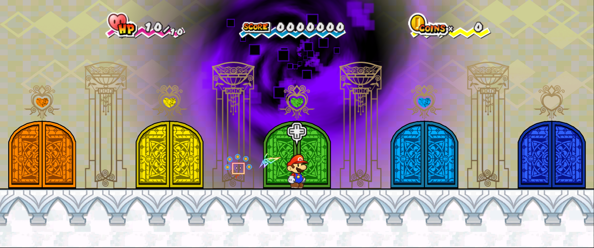

| | |
|---|---|
| 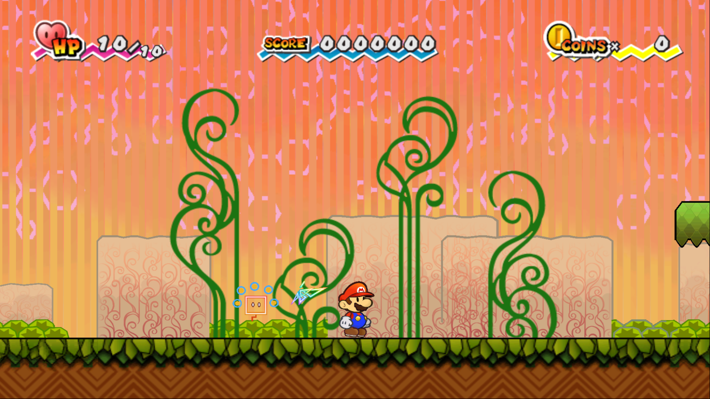 | 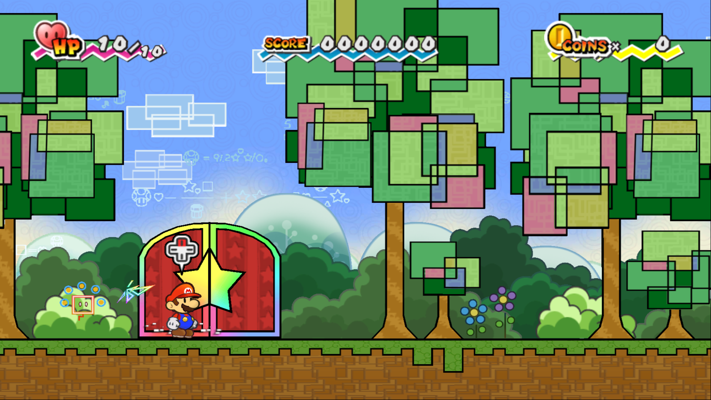 |
| 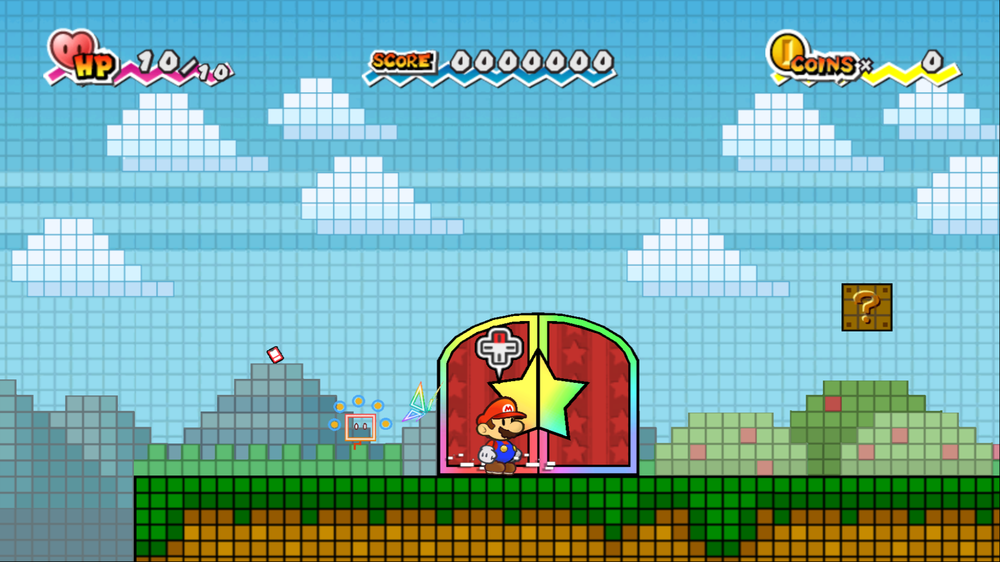 | 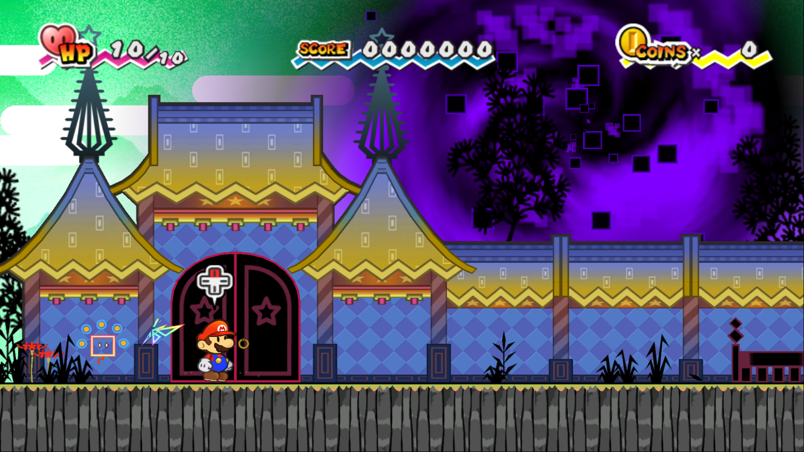 |

## Super Paper Mario ~ The Lost Pages (work in progress)

This fork is turning the port into **Super Paper Mario ~ The Lost Pages**: a revamp with TTYD-style turn-based
combat, Star Points, badges, and later a post-game side story. The changes so far are listed below; everything is in
the `lost-pages` branch.

### Enhanced lighting

A post-processing pass over the game's 3D scene, before the HUD is drawn:

- Paper diorama drop shadows on every layer, like Gloam Valley's look, plus ambient occlusion
- Glossy floors in the style of the TTYD remake: soft reflections of what stands on them, with a bright lip
- Sun rays only in open outdoor rooms, tinted with the area's own colours
- Per-pixel lighting, and a lighting section in the F10 settings menu to tune or turn off each effect

| Original | The Lost Pages |
|---|---|
| 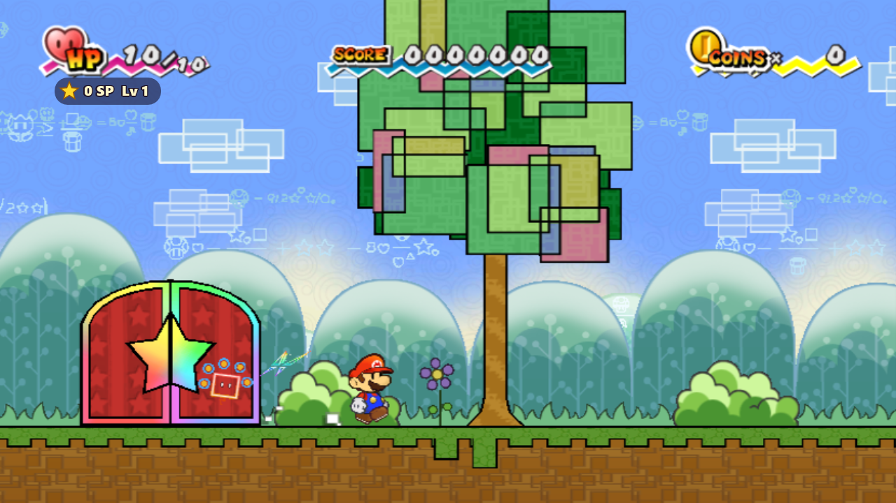 | 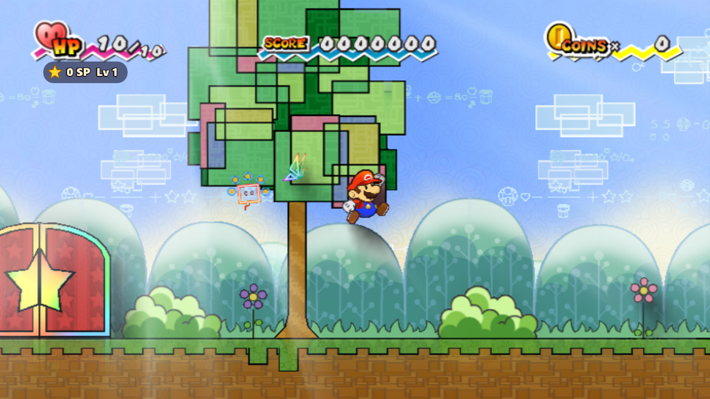 |

### Turn-based battles

Touching an enemy no longer trades stomp damage. It starts a TTYD-style turn-based battle:

- First strikes, a Jump/Hammer/Items command menu, action commands, and Guard/Superguard timing
- **Star Points** are earned for each enemy and act as EXP. At each level-up you choose **HP** or **ATK**
- Score is now cosmetic only, saved for a future Flipside cosmetics shop

Each battle draws a green-and-black zigzag border onto the screen, in SPM's digital style. A **pop-up paper
diorama of the area** then stands up behind the fighters, made of that area's typical scenery rather than a copy of
the spot. There are 16 area presets, from Lineland Road and Yold Desert to Outer Space and Castle Bleck. The lighting
stays on in battle: the fighters drop shadows onto the diorama, the stage floor is glossy, and sun rays shine
through outdoor skies.

| | |
|---|---|
| 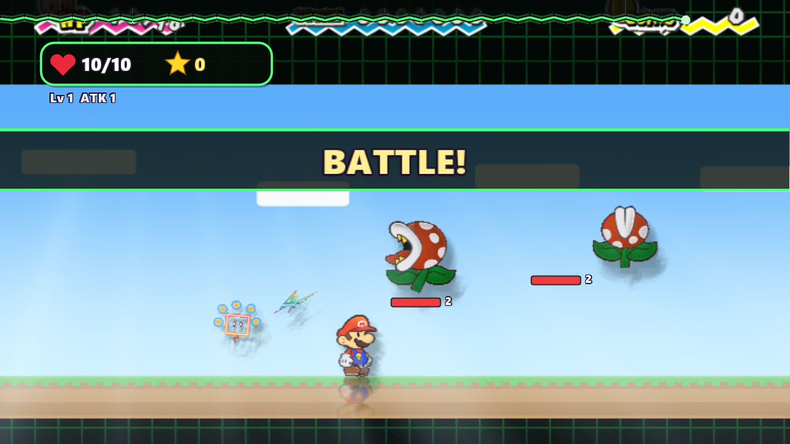 | 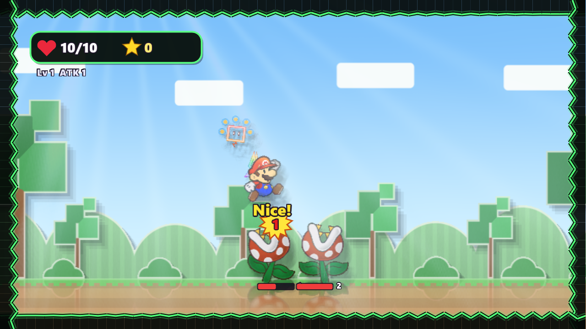 |
| 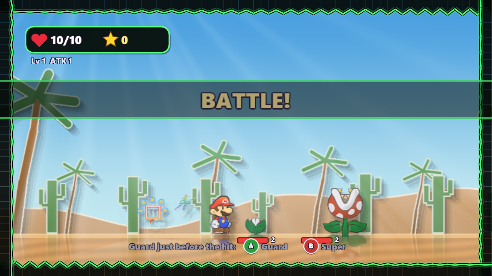 | 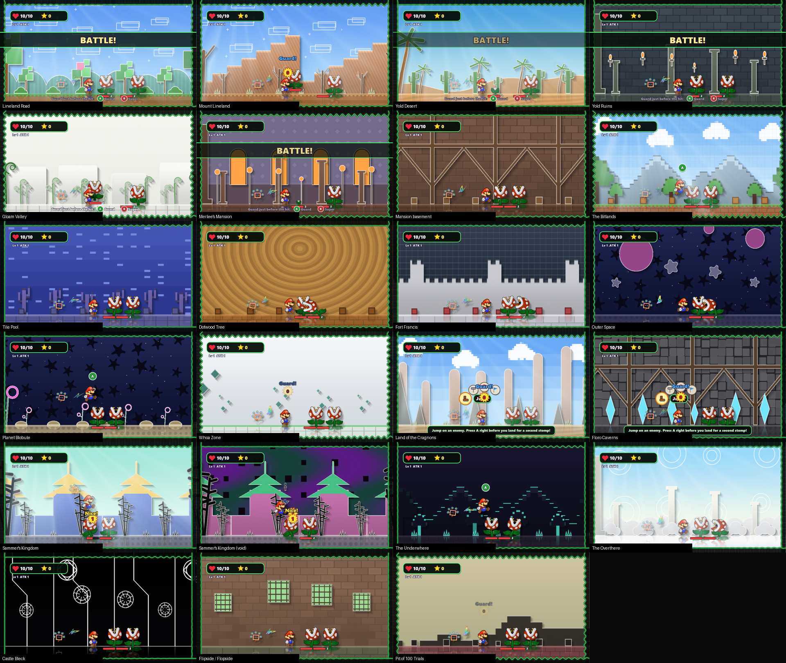 |

### Test area

Press **F10 on the title screen** to open a test room with blank green-and-white textures. It holds a roster of test
enemies (Goomba, Koopa Troopa, Sproing-Oing, Squiglet and Piranha Plant), and new features will be tried there first.

| | |
|---|---|
| 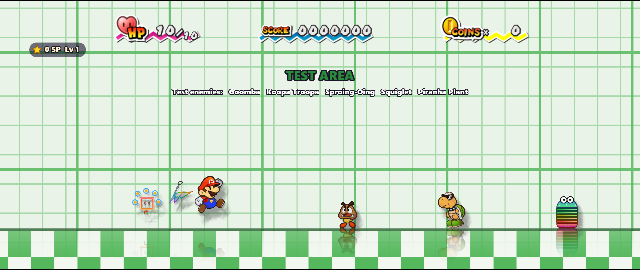 | 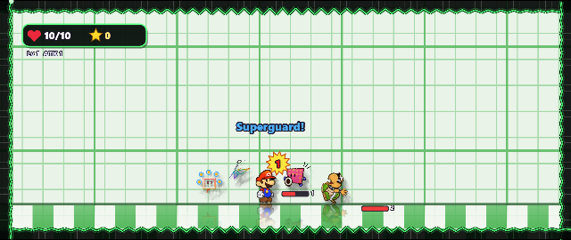 |

Design notes are in [docs/lost-pages](docs/lost-pages).

## Features

- Up to 4K, borderless 1080p by default
- Widescreen: 16:9, fill or cinematic 2.39:1, or the original 4:3
- Frame interpolation up to 240 fps (120, 180 or 240)
- Xbox, PlayStation and Nintendo gamepads plus keyboard, with press-to-bind remapping
- The Wii Remote pointer (Tippi, the HOME menu) on the right stick or the mouse
- On-screen buttons match your controller (Xbox, PlayStation or Nintendo), with a controls screen for it
- Mods: drop-in folders that replace game files or textures
- A launcher that installs the game from your own disc image

**No game data is included**: the game's files are read from your own copy of the game.

## How to play

You need **Windows 10/11 (64-bit)**, a graphics card with DirectX 12 or Vulkan, and your own dump of
**Super Paper Mario, USA Wii disc (R8PE01, revision 0) or European disc (R8PP01: English, French, German, Spanish, Italian)** as `.iso`, `.ciso` or `.wbfs`.

1. Download `NewSuperPaperBros.zip` from [Releases](../../releases) and unzip it.
2. Open `New Super Paper Bros.exe`. Windows may show "Windows protected your PC" because the exe isn't signed:
   click **More info**, then **Run anyway**.
3. On the **Play** page choose your disc image. The game files are copied into the `Disc` folder once; the image
   isn't needed after that.
4. Press **PLAY**.

In the game, F10 opens the settings menu and F11 switches between fullscreen and a window.

**Controls (Xbox layout):** left stick or D-pad = Wii Remote D-pad, A = 2 (jump), B or X = 1, Y = A, RB or RT = shake,
Start = +, Back or LB = -, right stick = pointer. Keyboard and mouse work too. Change them on the launcher's
**Controls** page.

**Mods:** on the launcher's **Mods** page, click **Open mods folder** and put each mod in its own folder:
`files\` mirrors the disc (replacing game files) and/or `textures\` holds texture replacements. Tick or untick mods
to switch them on and off.

**Saves from a Wii or Dolphin:** on the launcher's **Play** page click **Import Wii / Dolphin save...** and pick
`data.bin` (copied to an SD card from the Wii Menu's Data Management) or `wiimario00` in Dolphin's
`Wii\title\00010000\52385045\data` folder. Your current save is kept as a backup.

**Updating:** unzip a new release over the old folder. Your disc, saves, settings and mods are kept.

**Linux:** download `NewSuperPaperBros-linux.tar.gz` instead, unpack it and open `New Super Paper Bros` (the same
launcher). You need 64-bit Linux from 2022 or newer (glibc 2.35) with Vulkan graphics drivers. Linux support is new:
please report problems in [Issues](../../issues).

## Building from source

You need Windows, Python 3 and your own disc image. The toolchain (LLVM/MinGW, CMake, the .NET 8 SDK) is downloaded
into the repository's `toolchain\` and `wiicompiled\Dependencies\` folders on the first build; nothing is installed
system-wide.

```powershell
powershell -ExecutionPolicy Bypass -File tools\build-launcher.ps1
# Extract your disc image to Disc\DATA (the translation reads the game's code from it):
& "launcher\publish\New Super Paper Bros.exe" --extract "C:\path\to\Super Paper Mario.wbfs" Disc\DATA
# The game's code inputs in game\: the disc's main.dol (with the HQ music mod's two code patches; recomp.yml pins
# its hash) and relF.bin pre-linked at its boot address:
copy Disc\DATA\sys\main.dol game\main.dol
python wiicompiled\projects\spm\tools\prelink_spm_rel.py Disc\DATA\files\rel\relF.bin game\spm_linked.rel game\spm_rel_layout.json
powershell -ExecutionPolicy Bypass -File tools\build-spm.ps1
powershell -ExecutionPolicy Bypass -File tools\package-spm.ps1 -Zip
```

The packager also expects the HQ music mod in `Disc\DATA\files\sound` (originals in `Disc\sound_original`) and the
HD texture pack in `Play\UserData\texture_replacements\SPM_HD_4x_BC3`.

For Linux, after those steps run `bash tools/build-linux.sh` and `bash tools/build-linux.sh --pal` in WSL (Ubuntu
22.04) or on Linux, then `bash tools/package-linux.sh` for `dist/NewSuperPaperBros-linux.tar.gz`.

`build-spm.ps1` translates the game and compiles it into `Play\SuperPaperMario.exe`; `package-spm.ps1` assembles the
release folder in `dist\` (`-Zip` also writes the zip). `tools\sweep-spm-maps.py` loads every map and screenshots it
for regression checks.

| Folder | What it is |
|---|---|
| `wiicompiled/translator` | PowerPC to C++ static recompiler (C#) |
| `wiicompiled/runtime` | Runtime and Wii SDK HLE (OS, DVD, NAND, WPAD/KPAD, AX audio, VI, GX) |
| `wiicompiled/aurora-main` | Aurora: Wii GX on WebGPU (Dawn / Direct3D 12) |
| `wiicompiled/projects/spm` | This game's project: symbols and function map |
| `launcher` | The launcher (C# WinForms): disc setup, display options, controls, mods |
| `launcher/linux` | The same launcher for Linux (C# Avalonia) |
| `tools` | Build, package and test scripts |

## Credits

- **Port:** JosiahG
- **[WiiCompiled](https://github.com/patchzyy/Wiicompiled)** (the recompiler and runtime) by patchzyy and
  contributors, GPLv3
- **Aurora** by Luke Street, MIT; Dawn, SDL3 and the other components listed in
  [`wiicompiled/THIRD-PARTY-NOTICES.md`](wiicompiled/THIRD-PARTY-NOTICES.md)
- **Higher-quality music:** the "SPM High Definition Audio" mod by Toadette Hack Fan and PaperToadette, with game
  patches by JohnP55
- **HD textures:** converted from the "SPM Textures v1.0" HD texture pack
- **Controller button icons and pictures:** "Input Prompts" by [Kenney](https://kenney.nl), CC0
- **Dolphin Emulator** data files (DSP coefficients, Wii system files), GPL-2.0-or-later
- Symbol names from the Super Paper Mario decompilation community ([spm-decomp](https://github.com/SeekyCt/spm-decomp))

Full credits and licenses ship in the release as `CREDITS.txt`, `LICENSE.txt` and `engine\licenses\`.

## License

GPLv3, see [`wiicompiled/LICENSE`](wiicompiled/LICENSE). Bundled third-party components keep their own licenses.

Super Paper Mario and all related characters are trademarks and copyrights of Nintendo. This is an unofficial fan
project, not affiliated with or endorsed by Nintendo. This repository contains no game code or data; the release
contains the recompiled program, the community mods credited above and Nintendo character artwork used by the
launcher, but none of the game's disc data, which is read from your own copy of the game.
